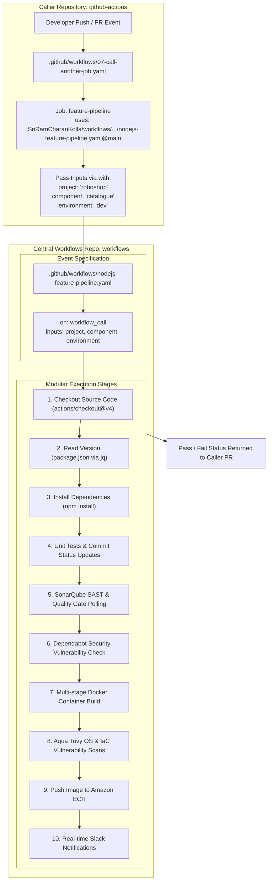

# Enterprise Reusable GitHub Actions Workflows (DevSecOps)

A centralized repository containing modular, enterprise-grade **Reusable GitHub Actions Workflows** (`workflow_call`) designed for the **RoboShop Microservices Platform** and developed as part of the **DevSecOps Hands-On CI/CD Course** in conjunction with [`github-actions`](../github-actions).

This repository implements the **DRY (Don't Repeat Yourself)** paradigm for GitHub Actions — serving as the GitHub-native equivalent of a **Jenkins Shared Library** — enabling any microservice or caller repository to invoke standardized CI/CD and security scanning workflows with minimal boilerplate.

---

## 🏗️ Architecture: Caller-to-Workflow Execution Flow



---

## 📁 Repository Structure

```
workflows/
├── README.md                      # Central architecture and usage documentation
└── .github/
    └── workflows/
        └── nodejs-feature-pipeline.yaml # Turnkey reusable workflow triggered via workflow_call
```

---

## 🔌 How It Works: Caller & Reusable Workflow Interplay

### 1. The Caller Workflow (`github-actions/.github/workflows/07-call-another-job.yaml`)

Consumer repositories (such as [`github-actions`](../github-actions) or microservices like `catalogue`, `cart`, `user`) define a lightweight trigger workflow that references this central repository using the `uses:` keyword:

```yaml
name: feature-pipeline

on: [push]

jobs:
  feature-pipeline:
    uses: SriRamCharanKolla/workflows/.github/workflows/nodejs-feature-pipeline.yaml@main
    with:
      project: 'roboshop'
      component: 'catalogue'
      environment: 'dev'
```

#### Key Mechanics:
- **`uses`**: Points to `<owner>/<repo>/.github/workflows/<workflow-file>.yaml@<branch-or-tag>`
- **`with`**: Passes typed parameter arguments defined in the callee workflow.
- **Inherited Context**: The callee workflow runs in the security and execution context of the calling repository, checking out the caller's code and utilizing the caller's configured secrets or runners.

---

### 2. The Reusable Workflow (`workflows/.github/workflows/nodejs-feature-pipeline.yaml`)

This repository defines the reusable workflow using the `workflow_call` trigger:

```yaml
name: nodejs-feature-pipeline-branch-workflow

on:
  # Triggered when invoked by another GitHub Actions workflow
  workflow_call:
    inputs:
      project:
        description: 'Project or ecosystem name (e.g., roboshop)'
        required: true
        type: string
      component:
        description: 'Microservice component name (e.g., catalogue)'
        required: true
        type: string
      environment:
        description: 'Deployment environment (e.g., dev, uat, prod)'
        required: true
        type: string

jobs:
  trigger:
    runs-on: ubuntu-latest
    steps:
      - name: checkout code
        uses: actions/checkout@v4

      - name: list files
        run: ls -la
```

---

## 🛡️ Enterprise DevSecOps Capabilities

In modern cloud-native architectures, reusable workflows enforce security guardrails across dozens of microservices simultaneously without relying on individual development teams:

```
┌────────────────────────────────────────────────────────────────────────┐
│                   DevSecOps Pipeline Quality Gates                     │
├────────────────────┬───────────────────────────────────────────────────┤
│ Security Phase     │ Implementation & Tools                            │
├────────────────────┼───────────────────────────────────────────────────┤
│ Code Quality & SAST│ SonarQube Scanner & Quality Gate Polling Action   │
│ SCA & SBOM         │ GitHub Dependabot API & Alert Severity Thresholds │
│ Container Build    │ Minimal Alpine Multi-stage OCI Container Images   │
│ Image Scanning     │ Aqua Security Trivy OS Vulnerability Scans        │
│ IaC Scanning       │ Trivy Config Misconfiguration Checks (Dockerfile) │
│ Artifact Registry  │ Authenticated Amazon ECR (IAM Role / Token)       │
│ Observability      │ Dynamic Slack Webhook Notifications with Details  │
└────────────────────┴───────────────────────────────────────────────────┘
```

---

## 💡 Benefits of Reusable Workflows vs. Legacy CI/CD

| Feature | Legacy Individual Workflows | Reusable Workflows (`workflow_call`) |
| :--- | :--- | :--- |
| **Maintenance** | 300+ lines duplicated across 10+ microservice repositories. | Single source of truth in `workflows` repository. |
| **Security Updates** | Patching a vulnerability scanner requires updates in every repository. | Updating one YAML file in `workflows` updates all microservices instantly. |
| **Consistency** | Risk of developers omitting tests, SonarQube, or Trivy gates. | Strict compliance is mandated centrally; no microservice can bypass rules. |
| **Audit & Governance** | Difficult to track pipeline compliance across teams. | Central repository acts as the auditable CI/CD standard for the enterprise. |

---

## 🚀 Calling Syntax Reference

To invoke any workflow from this repository in your project:

```yaml
jobs:
  call-workflow:
    uses: SriRamCharanKolla/workflows/.github/workflows/<workflow-name>.yaml@<ref>
    with:
      project: '<project-name>'
      component: '<component-name>'
      environment: '<env-name>'
    secrets: inherit # Optional: securely pass caller secrets to callee
```

- `@main`: Tracks the latest stable code on the main branch.
- `@v1.0.0`: Pins to a specific semantic release tag for immutable, production-grade safety.
- `secrets: inherit`: Automatically passes all repository and organization secrets from the caller to the reusable workflow.

---

## 🔗 Related Repositories

- [`github-actions`](../github-actions): Caller repository containing hands-on workflow triggers, contextual tests, and mobile APK build workflows.
- [`catalogue`](../catalogue): RoboShop Catalogue microservice consuming standardized CI/CD pipelines.
- [`jenkins-shared-library`](../jenkins-shared-library): Parallel Jenkins Shared Library implementing the same DRY governance patterns for Jenkins environments.
